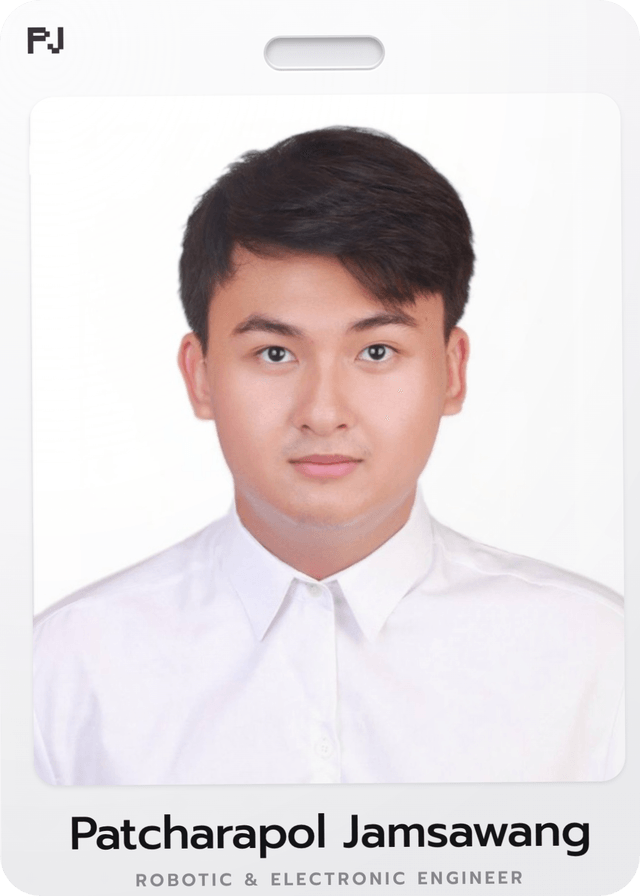

<!-- 💬 Typing header (types once, then holds) -->

  

<!-- 🌐 Social links -->
<table align="center">
  <tr>
    <td align="center" width="80">
      
    </td>
    <td align="center" width="80">
      
    </td>
    <td align="center" width="80">
      
    </td>
  </tr>
</table>

---

<!-- 💫 About me -->

##  About Me

- 🔧 I turn **sensors and microcontrollers into systems that actually work** — from wiring to dashboard.
- 🐍 **Python** is my daily language: data pipelines, automation, vision, backend.
- 🧠 Exploring **AI & Computer Vision** — YOLOv8, OpenCV, real-time inference.
- 🌬️ Built a **PM2.5 positive-pressure room** with 3 microcontrollers talking over ESP-NOW + UDP.
- 📐 Comfortable in **3D printing / CAD (OpenSCAD)** — if it needs a bracket, I'll design it.
- 🎯 Currently going deeper into **Docker, DevOps, and production-grade ML**.

 

---

### 🧰 Tech Stack

  

  
  
  
  
  
  

---

### 🚀 Featured Projects

| Project | What it does |
|---|---|
| 🌬️ **[JALIYATUM](https://github.com/NuiZaNaJa/JALIYATUM)** | Positive-pressure room that keeps PM2.5 dust out — 3 microcontrollers communicating via **ESP-NOW + UDP broadcast**, logging to **Google Sheets**. |
| 🕳️ **[ab129-pressure-monitor](https://github.com/NuiZaNaJa/ab129-pressure-monitor)** | Arduino Uno R3 + **BMP280** → LabVIEW → live **web dashboard (hPa)**, plus a 3D-printable pressure test rig. |
| 🏀 **[AI-Basketball-Tracking-](https://github.com/NuiZaNaJa/AI-Basketball-Tracking-)** | Real-time shot detection & scoring with **YOLOv8 + OpenCV** (fork of an open-source base, extended for study). |
| 🖥️ **[machineos](https://github.com/NuiZaNaJa/machineos)** | Private engineering playground for systems + containerized tooling. |

---

### 📊 GitHub Stats

  
  

  

---

### 🌱 Learning Next

- [x] 🐍 Solid Python for automation & data pipelines
- [x] 📡 ESP-NOW / UDP multi-node communication
- [x] 👁️ Real-time object detection with YOLOv8
- [ ] ☁️ **Docker + CI/CD** for deployable projects
- [ ] 🤖 **AI × IoT** — edge inference on cheap hardware
- [ ] 🌐 Ship a full-stack web app end to end
- [ ] ✍️ Write up my hardware builds so others can copy them

### 💭 Ask me about

**Microcontrollers & sensors** 🔌 · **Python automation** 🐍 · **3D-printed enclosures** 📐 · **anything embedded**

---

  <i>⭐ From <a href="https://github.com/NuiZaNaJa">NuiZaNaJa</a> — building hardware + code that talks to the real world.</i>

